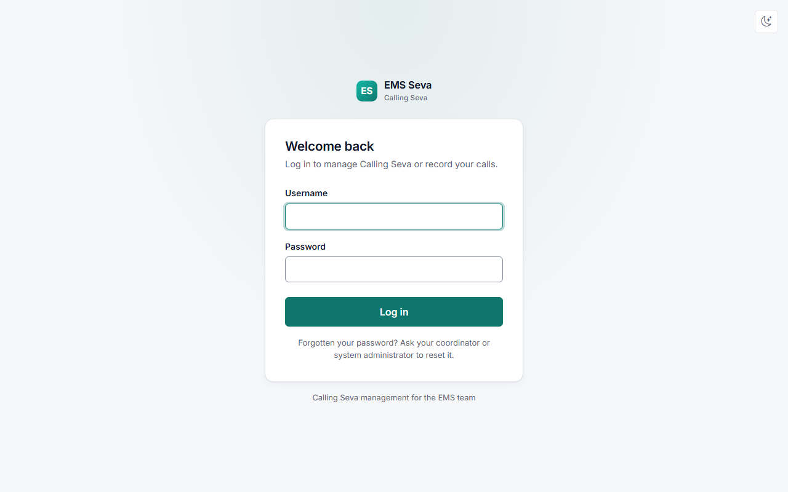
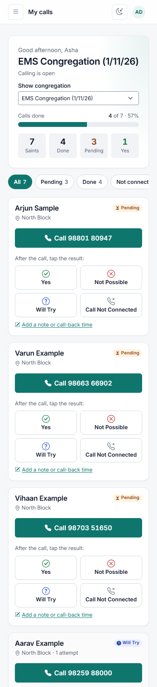

# EMS Seva — Caller manual

This is for everyone who does **calling seva**: phoning the Saints you look after before each
Sunday's EMS Congregation and recording what they said. It works best on your phone.

## 1. Log in

1. Open the EMS Seva link your coordinator gave you (for example `https://….pythonanywhere.com`).
2. Enter the **username** and **password** your coordinator gave you, then tap **Log in**.

> **Tip:** add the page to your phone's home screen — in Chrome: ⋮ → *Add to Home screen*;
> on iPhone Safari: Share → *Add to Home Screen*. It then opens like an app.

Forgotten your password? Tap **Forgot password?** on the login page and enter your email — a link
to choose a new password arrives by email. (No email saved? Ask your coordinator to reset it.)
After **5 wrong tries** the login is locked for an hour.

Once a day, after logging in, you see a short message:

> *I am truly blessed to have this Sewa. Thank you, Satguru Mataji, for blessing me with Sewa.
> Please do Simran before starting the Sewa.*

Tap **Begin Sewa** to continue.

On a phone, the bar at the bottom has your three pages: **My calls**, **My Report** and
**Request**.

## 2. My calls

After logging in you see **My calls**:

- **At the top:** which EMS Congregation you are calling for, how many calls are done, and four
  numbers — **Saints** (your list), **Done**, **Pending** and **Yes**.
- **Below:** one card for each Saint, with their name and area. Pending calls come first.
- If calling has not started yet you will see *"No calls to make yet"* — your list appears when
  your coordinator starts calling, usually on **Saturday morning**.
- If you see **"No Calling Sewa this week"**, there is no calling that week — please do not call;
  results cannot be recorded.
- If you made fewer than 75% of your calls last month, a gentle note reminds you of the goal. If
  you need a break, use **Raise Request** (section 6).

## 3. Make a call

1. Tap the green **📞 Call** button on a Saint's card. Your phone's dialler opens.
2. After the call, tap **one** result:

| Button | Tap it when… |
|---|---|
| **Yes** | They will come to the EMS Congregation |
| **Not Possible** | They said they cannot come |
| **Will Try** | They are not sure (this is **not** counted as a Yes) |
| **Call Not Connected** | No answer, switched off, busy or wrong number |

The result is saved straight away and the card shows it (for example *Will Try*).

**Called again later?** Just tap the new result. The **latest** result counts; earlier ones are
kept in the history.

## 4. Remarks and call-back time

Tap **Add remarks or call-back time** under a card (or tap the Saint's name) to:
- write your remarks, e.g. *"Coming with a friend"*;
- set a **call-back time** if they asked you to call later — it shows on the card, and the
  **Call back** filter lists them.

Choose the result, then tap **Save result**.

## 5. Filters

The chips under the progress bar show:
**All** · **Pending** (not called yet) · **Done** · **Not connected** (try again) · **Call back**.

When everything is done you will see *"All calls done — thank you for your seva."*

## 6. Raise Request

Use **Raise Request** (menu, or *Raise request* under a Saint's card) to tell your coordinator:

- **Saint is unable to attend EMS** — e.g. they moved away or work every Sunday. If your
  coordinator approves, the Saint is taken off your list.
- **Wrong or changed mobile number**
- **Please give this Saint to another caller**
- **I need a break (On Leave)** — your coordinator gives your Saints to someone else while you are
  away.
- **Something else**

Choose the Saint (when it is about one), type your remarks and tap **Send request**. Under
**My requests** you see whether it was approved, with any note from your coordinator.

## 7. My Report

**My Report** shows your own Calling Sewa for the last 3, 6 or 12 months: calls given, calls made,
connected and Yes, a chart of the % of calls made for each congregation (the line is the 75% goal —
tap a bar for its numbers), and a table of every congregation.

## 8. Things to know

- You only see **your own** Saints. Nobody else's list is visible to you, and yours is not visible
  to other callers.
- Once your coordinator **closes calling** for the week, results can no longer be changed.
- Earlier weeks: if you have more than one congregation, use **Show congregation** at the top to
  look back (read-only).
- **Change your password:** tap your initials at the top right → **Change password**.
- **Dark theme:** tap 🌙 (or ☀️) at the top.
- **Log out** on shared phones: tap your initials → **Log out**.

## 9. Privacy

The Saints' names and phone numbers are private. Do not share screenshots of your list or forward
the numbers. Use them only for calling seva.
