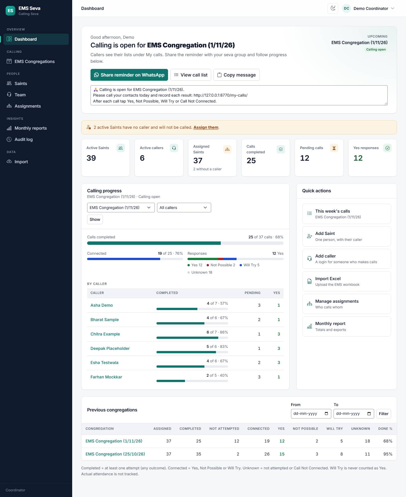
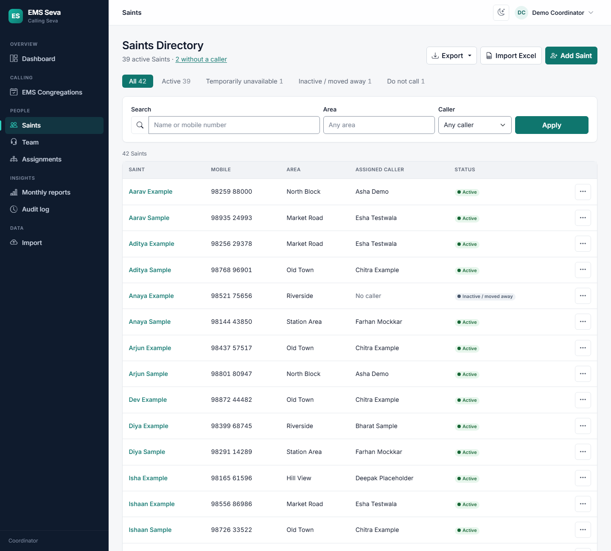
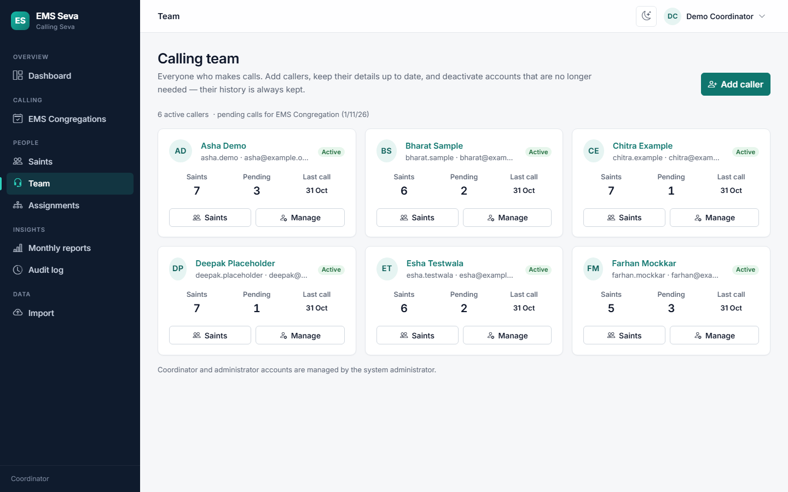
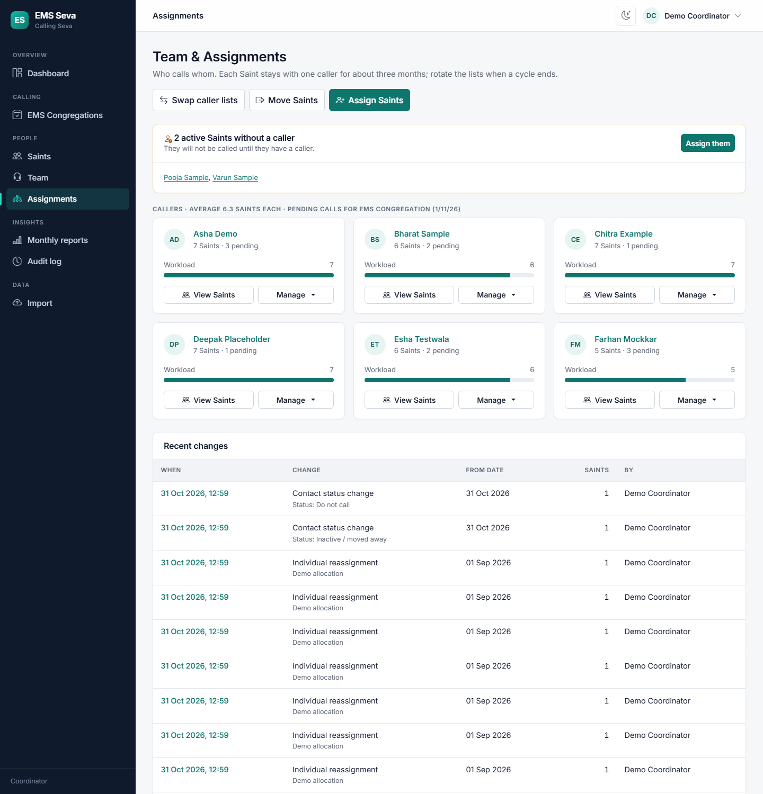
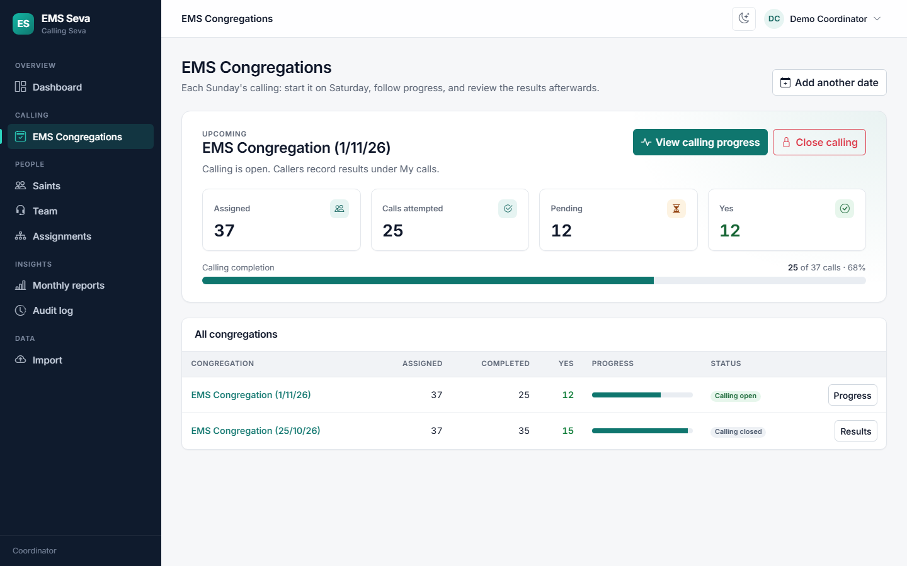
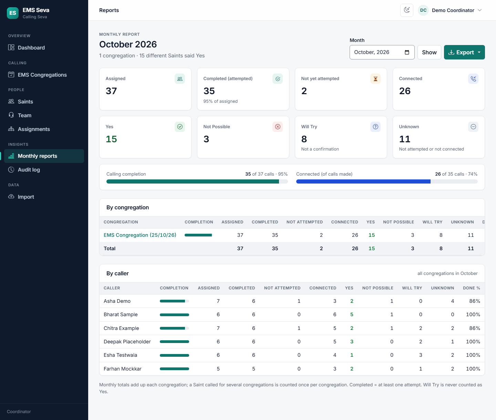
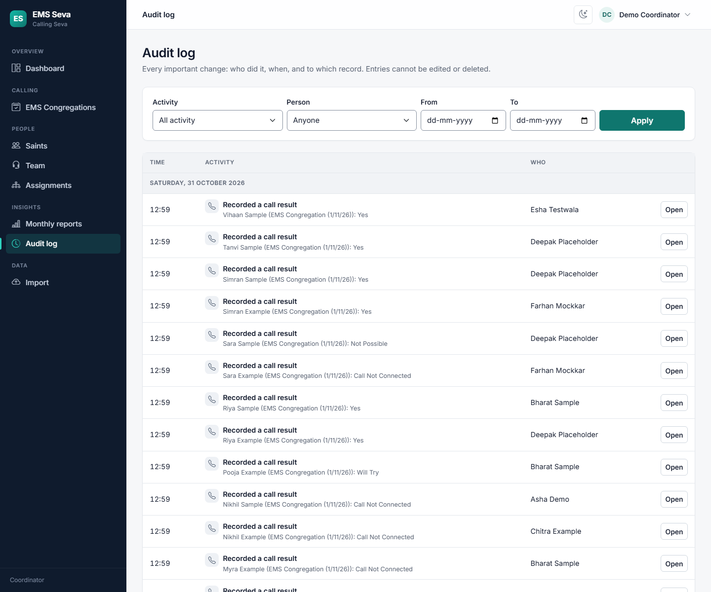

# EMS Seva — Coordinator manual

For coordinators who run Calling Seva: the Saints, the calling team, who calls whom, each
Sunday's calling and the reports. Each Sunday EMS is shown as an **EMS Congregation**,
for example *EMS Congregation (1 Nov 2026)*.

**Contents:** [1 Getting around](#1-getting-around) · [2 Dashboard](#2-dashboard) ·
[3 First-time setup](#3-first-time-setup) · [4 Saints](#4-saints) · [5 Team](#5-team-callers) ·
[6 Assignments](#6-assignments-who-calls-whom) · [7 Every week](#7-every-week-calling) ·
[8 Reports](#8-reports) · [9 Import from Excel](#9-import-from-excel) · [10 Audit log](#10-audit-log) ·
[11 Requests](#11-requests-from-callers) · [12 Stall Lead login](#12-stall-lead-login) ·
[13 Questions](#13-common-questions)

---

## 1. Getting around

Log in with the username and password from your system administrator. Forgot it? Tap **Forgot
password?** on the login page; a reset link is emailed to the address saved in your account.
Once a day after logging in, a short message reminds you to do Simran before starting the Sewa;
tap **Begin Sewa**.

- **Left menu** (on a phone: tap ☰): Dashboard · EMS Congregations · Requests · Saints ·
  Calling Team · Performance · Assignments · Reports · Audit log · Import. If you also make calls,
  **My calls**, **My Report** and **Raise Request** appear too.
- **Top right:** 🌙/☀️ switches light and dark theme; your name opens **Change password** and
  **Log out**.
- Green buttons are the main action on each page. Nothing that changes many records happens
  without a **preview** or a **confirmation**.

## 2. Dashboard

The dashboard adapts to where you are:

| What you see at the top | Meaning | Main button |
|---|---|---|
| *Let's get Calling Seva ready* + a **Setup** checklist | No callers yet, no Saints, or Saints without callers | The next setup step |
| *Ready for EMS Congregation (date)* | Everything is set; calling has not started | **Start calling** |
| *Calling is open for …* | Callers are calling now | **Share reminder on WhatsApp**, **View call list** |
| *Calling closed for …* | The week is finished | **View results** |

Below that:
- **Six numbers:** Active Saints (New + Active), Active Team Members, Saints with a caller, Calls
  completed, Pending calls, Yes responses — then **Saints by status** (tap one to open that list).
- **Calling progress:** overall bar, connected, the Yes / Not Possible / Will Try / Unknown bar and
  one row per caller. Use the drop-downs to look at another congregation or one caller.
- **Quick actions** and **Previous congregations** (filter by date).
- Notices: requests waiting for you, callers On Leave who still have Saints, Saints without a
  caller, On Hold Saints whose next call date has come, or a three-month cycle ending.
- **No Calling Sewa this week** (at the bottom of the top card): if there is no EMS this Sunday,
  type an optional reason and press it. Calling cannot start, callers see a notice and cannot record
  results, and no reminder emails go out. **Calling Sewa is on after all** switches it back.

## 3. First-time setup

Follow the **Setup** checklist on the dashboard:

1. **Create caller logins** — either in **Calling Team → Add caller**, or let the import create them from
   the workbook (section 9).
2. **Bring in the Saints** — **Import** the EMS workbook (section 9), or **Saints → Add Saint**.
3. **Give every Saint a caller** — the import does this from the workbook; check **Assignments**.
4. **Start calling** — on Saturday (section 7).

## 4. Saints

**Saints Directory** (menu: Saints)
- The buttons at the top filter by status and show counts.
- **Search** by name or part of the mobile number. On a phone, the filter icon next to the search
  box opens **Area** and **Caller** (choose *No caller* to find Saints nobody is calling). Click
  **Search**; the ✕ clears filters.
- **⋯** on a row: View details · Edit · Change status · Delete.
- **Export** (on a phone under **⋯**) downloads the list as Excel or CSV, including Skills and Sewa.

**Add a Saint:** **Add Saint** → name, mobile, area and the date they were met at the stall are
required; Skills, Sewa and the rest are optional; optionally choose their caller and from which
date. If the mobile number is already used
by someone else you get a warning — tick the confirmation only if it really is a different person
(for example a shared family phone). Saints are never merged automatically.

**Saint page** (click a name): details, a tap-to-call button, and three history tabs —
**Calls**, **Caller history** and **Status history**. On the right:

- **Caller** — move the Saint to another caller from a chosen date, with a reason.
- **Change status:**

| Status | Use when | What happens |
|---|---|---|
| New | Set automatically for **6 months after the stall date** | Called every week like Active; must be given a caller. Becomes **Active by itself** after 6 months |
| Active | Normal | Called every week |
| On Hold | A pause for a while (exams, travel, illness). The **next call date** is filled in as 6 months ahead; change it if needed | Not called; keeps their caller; the dashboard reminds you when the date comes |
| Inactive | Moved away, can no longer attend, or asked not to be called | Not called; their caller assignment ends |

You can change any status by hand at any time.

Calls already made and all history are always kept.

**Delete a Saint** (coordinators and system administrators) — for Saints added by mistake or
twice. On the Saint page click **Delete**, or on the Saints Directory tick several rows (the box in
the heading ticks the whole page) → **Delete selected**. A confirmation page lists who will be
deleted; add a reason if you like and confirm. Their caller assignments, status history and
not-yet-called places on call lists go with them. This cannot be undone, and each delete is
recorded in the Audit log.

A Saint who **already has call results** cannot be deleted, because those results are part of past
congregation reports. They are shown as *Kept* on the confirmation page — use **Change status →
Inactive** for them instead.

## 5. Calling Team

Each card shows a status with a coloured edge:

| Status | Meaning |
|---|---|
| Active | Calling normally |
| Partially Active | Made **fewer than 75%** of their calls in the last month — set automatically; the card turns amber and the caller sees a gentle note on My calls |
| On Leave | Taking a break (you set it, or you approved their request) |
| Inactive | Deactivated; cannot log in |

- **Add caller:** first name, last name, username, email (needed only for Saturday reminder
  emails) and a password of at least 10 characters. Share the username and password privately.
- Each card shows the caller's number of Saints, pending calls this week and the % of calls made
  last month. **Saints** opens their list; **Manage** opens their page.
- **On Leave:** on a caller's page → **Mark On Leave** (optional reason). You are taken straight to
  **Move Saints** to give their list to someone else; until you do, the dashboard reminds you.
  When they return: **Back from leave** lists the Saints moved during the leave — they **stay with
  the new caller** unless you tick them to move back.
- **Performance** (menu, or the button on Calling Team): callers sorted from best to worst by calls
  made ÷ calls given, for the last 1, 2 or 3 months, with the 75% goal line.
- On a caller's page: **Edit**, **Reset password** (they are signed out everywhere and use the new
  one), and **Deactivate**.
- **Deactivate** when someone stops doing seva: they can no longer log in; **their Saints become
  "without a caller"** (assign them to someone else on Assignments); their calls not yet made this
  week are withdrawn, calls already made stay credited to them. **Reactivate** lets them log in
  again — give them Saints again afterwards.
- You can manage **callers only**. Coordinator and administrator accounts are managed by the
  system administrator.

## 6. Assignments (who calls whom)

Each Saint stays with **one caller for about three months**. The page shows a card per caller
with their number of Saints, a workload bar and pending calls, plus a yellow panel listing Saints
without a caller.

| To… | Do this |
|---|---|
| Give Saints without a caller to someone | **Assign Saints** (or *Assign Caller* in the yellow panel) → tick the Saints → choose the caller |
| Move one Saint | On the Saint's page, **Caller → Move to this caller** |
| Move a caller's whole list (e.g. they are leaving) | **Move Saints** → From caller → To caller |
| Exchange two callers' lists (three-monthly rotation) | **Swap caller lists** → Caller A and Caller B |
| Rotate lists among several callers | *Advanced* → **Rotate among several callers** |

Every change asks for a **from date** and a **reason**, shows a **preview** (who moves from whom
to whom, and new list sizes) and only happens when you click **Apply**. If calling is open that
week, calls not yet made move to the new caller; calls already made stay with the original caller.
**Recent changes** lists every change; click one to see exactly which Saints moved.

**Cycles** (*Advanced*) are optional labels for each three-month period. The dashboard warns you
when the current cycle is ending.

## 7. Every week: calling

| When | What to do |
|---|---|
| **Saturday morning** | Dashboard (or EMS Congregations) → **Start calling for EMS Congregation (date)**. One click creates the coming Sunday, builds each caller's list from their Saints, and closes last week's calling. |
| Straight after | **Share reminder on WhatsApp** → choose your seva group → send. (If the administrator set up reminder emails, callers also get an email.) |
| During the day | Watch the **Dashboard**: completed, pending and results for each caller. Remind anyone who is behind. |
| New Saint added during the week | They are added to their caller's list automatically. **Refresh call lists** on the congregation page catches anything missed. |
| After Sunday | Open the congregation → **Export** the summary or the call list if you need it. You don't have to close it — next Saturday's *Start calling* closes it. |

On a congregation's page you can also **Close calling** (callers can no longer change results),
**Reopen calling**, and **Edit**. **Add another date** is only for an extra congregation or a
different venue.

## 8. Reports

**Reports** has three buttons: **Weekly** (one congregation — pick it from the list), **Monthly**
(pick a month → **Show**) and **3 Months** (the last three months, week by week). Each gives the
eight numbers, overall completion, and tables by congregation and by caller. **Export** downloads
Excel or CSV of what is on screen.

| Number | Meaning |
|---|---|
| Assigned | Calls on the lists |
| Completed | At least one attempt, any result |
| Not yet attempted | Not called |
| Connected | Yes, Not Possible or Will Try |
| Yes / Not Possible / Will Try | The latest result |
| Unknown | Not called yet, or Call Not Connected |

Yes + Not Possible + Will Try + Unknown always equals Assigned. **Will Try is never counted as
Yes.** Actual attendance on Sunday is not recorded.

## 9. Import from Excel

The import brings in the **current Saints and their callers** from the EMS workbook. Old weekly
results are **not** imported. Nothing is saved until the last step, and importing the same file
again never creates duplicates.

From the sheet **EMS STALL SEWA** it uses: **NAME**, **MOBILE NO**, **AREA**, **DATE** (the day
the Saint was met at the stall), **CALLING CO-ORDINATER** (the Saint who calls them), and optionally
**QUALIFICATION** and **SEWA CONDUCTED BY**. The sheet is found even when its name has a year in
front (for example *2026 EMS STALL SEWA*); other sheets in the file are never read.

1. **Upload** — **Import → Upload workbook**, drop or choose the file. Leave the optional tick box
   (status-sheet comparison) and *Advanced* empty unless you need them.
2. **Map columns** — check each field points to the right column (they are matched automatically),
   then **Check the rows**.
3. **Review**
   - The numbers show rows that are ready, need your attention, have warnings, are already in the
     app, or are skipped, plus possible duplicates, invalid mobiles, missing details and callers
     not matched. Click a number to see those rows.
   - **Create caller logins:** callers in the workbook without a login are listed with a suggested
     username. Untick any that are only a different spelling of an existing person, then **Create
     ticked logins**. The usernames and passwords are shown **once** — copy, download or print
     them and share each one privately.
   - **Callers in the workbook:** each name and who it is matched to; change it if needed
     (tick *remember* for future imports), or choose *No caller (assign later)*.
   - **Rows** marked *Need your attention*: click **Fix** — correct the value, link to an existing
     Saint, create as new, or skip with a reason.
4. **Import** — check *What will happen* and *Saints per caller*. Enter a name for the current
   three-month period and the date the current caller lists started (not the stall date), tick the
   confirmations, and click **Import**. The **Import** button stays disabled until every row is
   dealt with.

Afterwards you see a summary; click **Check assignments** to confirm everyone has their Saints.
**Cancel this import** at any time before step 4 discards it.

## 10. Audit log

Every important change, in plain words: who did it, when, and **Open** to go to the record.
Filter by **Activity** (Saints, Assignments, Calling, Team, Import, Exports, Reminders), **Person**
(or *System* for automatic actions) and date range. Entries cannot be edited or deleted.

## 11. Requests from callers

Callers use **Raise Request** to tell you, for example, that a Saint is unable to attend EMS, a
number is wrong, a Saint should go to another caller, or that they need a break. The **Requests**
menu shows a count of waiting requests and the dashboard shows a notice; coordinators with an email
address also get an email.

Open **Requests**, read the reason, optionally add a note to the caller, and press **Approve** or
**Not approve**. Approving:

| Request | What happens |
|---|---|
| Saint is unable to attend EMS | The Saint becomes **Inactive** and is taken off the call lists |
| I need a break (On Leave) | The caller is marked **On Leave**; then give their Saints to someone else |
| Wrong number / another caller / something else | Nothing changes by itself — use the link shown to edit the number or move the Saint |

The caller sees the answer and your note under **Raise Request → My requests**.

## 12. Stall Lead login

The stall team uses one shared login, **stall.sewa.admin** (the system administrator creates it).
It can only **add new Saints**: name, mobile, area, the date met at the stall, qualification,
skills, sewa, notes and — compulsory — **the name of the person adding**. It cannot assign callers,
see call results or open other pages. New Saints from the stall appear as **New** without a caller:
give them one on **Assignments**. The duplicate-mobile check works there too, without showing other
Saints' names.

## 13. Common questions

**A caller can't log in.** They can use **Forgot password?** if their email is saved. After 5
wrong passwords the login is locked for an hour. Reset their password on their Calling Team page;
if still locked, ask the system administrator to unlock it.

**A Saint is missing from a caller's list.** Check on the Saint's page that they are *New* or
*Active* and have a caller, then **Refresh call lists** on the congregation page.

**Someone was given to the wrong caller.** Move them on the Saint's page; the history keeps both.

**We pressed Start calling too early.** It is harmless — it is simply the coming Sunday's list.
Leave it open. (If you close it, *Start calling* will not reopen that Sunday by itself; use
**Reopen calling** on its page.)

**Can a caller see other callers' Saints?** No. Callers only ever see their own list.
